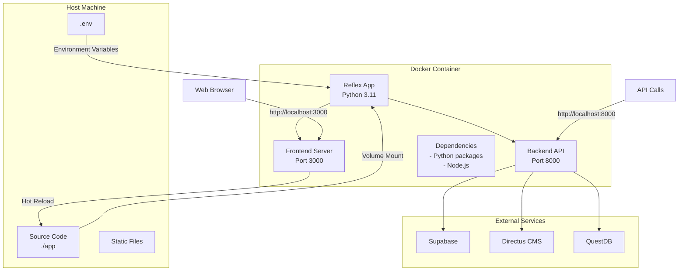
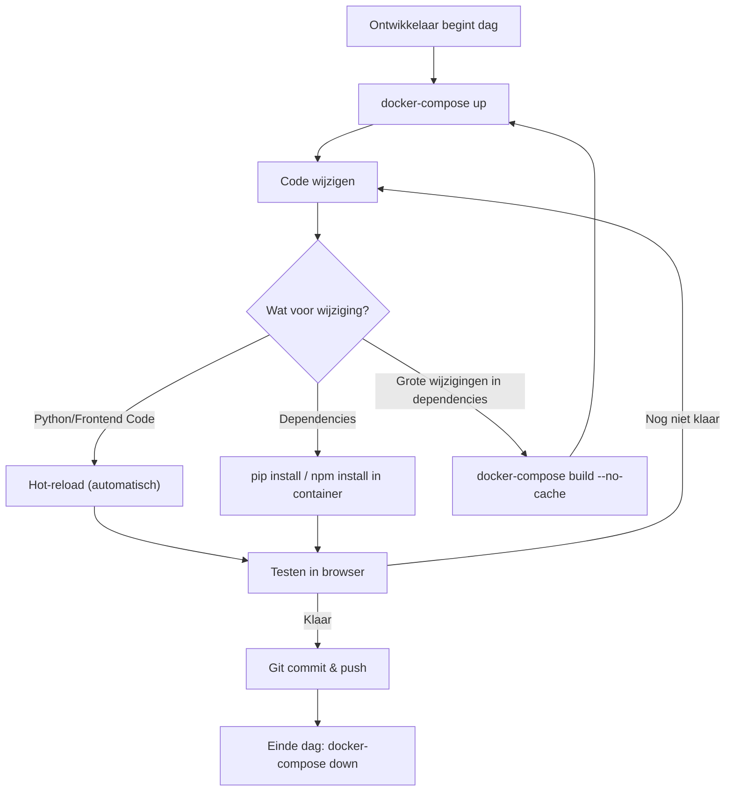

# Stappenplan voor lokale deployment van Reflex App met Docker

## Inleiding
Dit document beschrijft de stappen voor het lokaal deployen van de Volta-Optima Reflex applicatie met Docker in een ontwikkelomgeving. De focus ligt op een optimale developer experience met hot-reloading en andere ontwikkelingstools.

## Architectuur Overzicht



Deze architectuur toont hoe de lokale ontwikkelomgeving is opgebouwd met Docker, waarbij de broncode als volume wordt gemount voor directe ontwikkeling met hot-reloading.

## 1. Aanpassen van de Dockerfile voor ontwikkelomgeving

De huidige Dockerfile is geconfigureerd voor productie (`--env prod`). Voor een ontwikkelomgeving zijn de volgende aanpassingen nodig:

```dockerfile
FROM python:3.11-slim

# Systeem dependencies installeren (inclusief Node.js)
RUN apt-get update && apt-get install -y \
    curl \
    && curl -fsSL https://deb.nodesource.com/setup_20.x | bash - \
    && apt-get install -y nodejs \
    # Toevoegen van apt-packages.txt dependencies
    libcairo2 \
    libpango-1.0-0 \
    libpangocairo-1.0-0 \
    libgdk-pixbuf2.0-0 \
    libffi-dev \
    shared-mime-info \
    libnss3 libnspr4 libatk1.0-0 libatk-bridge2.0-0 libcups2 libdrm2 libxkbcommon0 \
    libxcomposite1 libxdamage1 libxfixes3 libxrandr2 libgbm1 libasound2 \
    # Git voor ontwikkeling
    git \
    # Extra tools voor development
    vim nano \
    && rm -rf /var/lib/apt/lists/*

WORKDIR /app

# Kopieer requirements eerst, voor betere layer caching
COPY requirements.txt .

# Installeer dependencies
RUN pip install --no-cache-dir -r requirements.txt
RUN pip install --no-cache-dir reflex 

# Bij ontwikkelomgeving wordt de code gemount via volume
# We kopiëren dus niet de code in de image

# Initialiseer Reflex
RUN reflex init

# Exposing Reflex ports
EXPOSE 3000 8000

# Standaard kommando (overridable via docker-compose)
CMD ["reflex", "run", "--env", "dev", "--loglevel", "debug"]
```

## 2. Creëren van een docker-compose.yml bestand

Maak een `docker-compose.yml` bestand aan voor eenvoudigere ontwikkeling:

```yaml
version: '3.8'

services:
  reflex-app:
    build: 
      context: .
      dockerfile: Dockerfile
    volumes:
      - .:/app
      # Excludeer volumes die niet nodig zijn voor dev
      - /app/node_modules
      - /app/.web
    ports:
      - "3000:3000"  # Frontend
      - "8000:8000"  # Backend API
    environment:
      - REFLEX_DEV_MODE=true
      # Voeg alle benodigde environment variabelen toe uit .env
      - ADVICE_LIMIT_LOGGED_IN_MULTIPLIER=${ADVICE_LIMIT_LOGGED_IN_MULTIPLIER}
      - ADVICE_LIMIT_PER_DAY=${ADVICE_LIMIT_PER_DAY}
      - ADVICE_LIMIT_TOTAL=${ADVICE_LIMIT_TOTAL}
      - DIRECTUS_API_KEY=${DIRECTUS_API_KEY}
      - DIRECTUS_URL=${DIRECTUS_URL}
      - GITHUB_TOKEN=${GITHUB_TOKEN}
      - GOOGLE_ANALYTICS_ID=${GOOGLE_ANALYTICS_ID}
      - GOOGLE_API_KEY=${GOOGLE_API_KEY}
      - QUESTDB_PASSWORD=${QUESTDB_PASSWORD}
      - QUESTDB_URL=${QUESTDB_URL}
      - QUESTDB_USERNAME=${QUESTDB_USERNAME}
      - RESEND_API_KEY=${RESEND_API_KEY}
      - SUPABASE_KEY=${SUPABASE_KEY}
      - SUPABASE_URL=${SUPABASE_URL}
    command: reflex run --env dev --loglevel debug
```

## 3. Opzetten van .dockerignore bestand

Maak een `.dockerignore` bestand aan om onnodige bestanden uit te sluiten van de Docker context:

```
# Python
__pycache__/
*.py[cod]
*$py.class
*.so
.Python
env/
build/
develop-eggs/
dist/
downloads/
eggs/
.eggs/
lib/
lib64/
parts/
sdist/
var/
*.egg-info/
.installed.cfg
*.egg
.env.local

# Node.js
node_modules/
npm-debug.log
yarn-debug.log
yarn-error.log

# Reflex
.web/
.reflex/

# IDE
.idea/
.vscode/
*.swp
*.swo

# OS specific
.DS_Store
.DS_Store?
._*
.Spotlight-V100
.Trashes
ehthumbs.db
Thumbs.db

# Git
.git/
.gitignore
```

## 4. Testen van de Docker build

Voer de volgende commando's uit om de Docker image te bouwen:

```bash
docker-compose build
```

## 5. Draaien van de container en testen van de applicatie

Start de container met:

```bash
docker-compose up
```

De applicatie zou beschikbaar moeten zijn op:
- Frontend: http://localhost:3000
- Backend API: http://localhost:8000

## 6. Configureren van hot-reloading voor ontwikkeling

Reflex ondersteunt standaard hot-reloading in development mode. Door het mounten van de code als volume in de container, worden wijzigingen automatisch gedetecteerd en wordt de applicatie opnieuw geladen.

Om hot-reloading te optimaliseren:

1. Zorg ervoor dat je de `--env dev` flag gebruikt in het run commando (is al geconfigureerd in docker-compose.yml)
2. Controleer of alle benodigde volumes correct gemount zijn
3. Vermijd het mounten van node_modules en .web directories om performanceproblemen te voorkomen

## 7. Documenteren van het build en run proces

Creëer een README.md bestand in de repository om het build en run proces te documenteren:

```markdown
# Volta-Optima Lokale Ontwikkeling

## Vereisten
- Docker
- Docker Compose

## Lokale Ontwikkeling met Docker

### Eerste keer opstarten
1. Clone de repository
2. Zorg ervoor dat je een `.env` bestand hebt met de benodigde variabelen
3. Build de Docker image:
   ```
   docker-compose build
   ```
4. Start de applicatie:
   ```
   docker-compose up
   ```

### Dagelijkse Workflow
- Start de applicatie: `docker-compose up`
- Stop de applicatie: `docker-compose down`
- Rebuild na wijzigingen in requirements: `docker-compose build --no-cache`

### Toegang tot de applicatie
- Frontend: http://localhost:3000
- Backend API: http://localhost:8000

### Troubleshooting
- Als de applicatie niet correct opstart, controleer de logs: `docker-compose logs`
- Bij problemen met dependencies, probeer de image opnieuw te bouwen: `docker-compose build --no-cache`
```

## Ontwikkelingsworkflow



Deze workflow laat zien hoe een ontwikkelaar door een typische dag gaat bij het werken met deze Docker-gebaseerde ontwikkelomgeving voor de Reflex app.

## Volgende stappen

Na succesvolle lokale deployment met Docker, kan er overgegaan worden naar de deployment op Railway volgens de Railway-specifieke best practices.